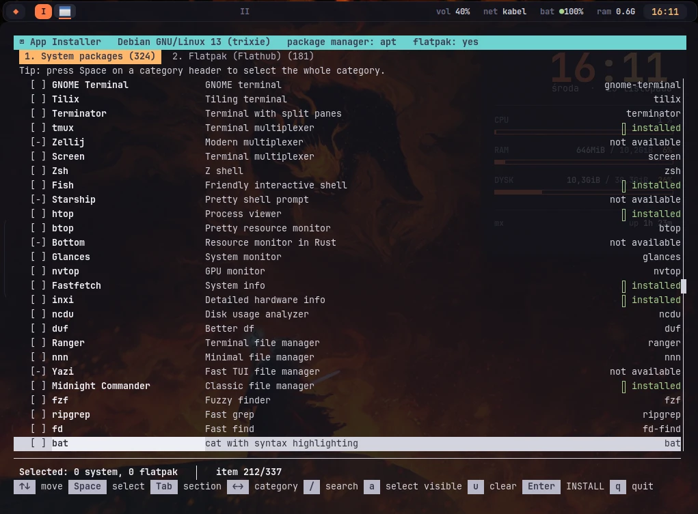

# 📦 Linux App Installer

**Pick the apps you want from a terminal menu and install them all at once, on any major Linux distro.**

A single-file Python TUI with **500+ popular programs** (324 native packages + 181 Flatpaks).
Select what you want with the spacebar, hit Enter, and the script detects your package manager
and installs everything for you.



## ✨ Features

- **500+ curated apps** in categories: browsers, chat, audio/video, graphics, office, development,
  terminal tools, system tools, file managers, networking, security, games, fonts
- **Automatic package manager detection:** `pacman`, `apt`, `dnf`, `zypper`
- **AUR support** on Arch-based distros via `paru` or `yay`. If you have neither, it offers to install `yay`
- **Flatpak section:** installs Flatpak and adds Flathub if they're missing
- **RPM Fusion support** on Fedora: offers to enable it for Steam, Kodi, VirtualBox, etc.
- **Automatic Flatpak fallback:** if an app (e.g. Brave, Discord, Spotify) isn't in your distro's
  repositories, it's offered as a Flatpak right in the system list
- **Shows what's already installed** and greys out apps that aren't available at all
- **Search** (`/`) and **select a whole category** with one key
- **Handles errors:** installs everything in one go, retries failed packages one by one, and
  checks what actually got installed so a failing distro hook doesn't cause false errors
- **Dry-run mode** to see every command before anything runs
- **Zero dependencies:** only Python 3 from the standard library

## 🐧 Supported distributions

| Family | Package manager | Tested names against |
|---|---|---|
| Arch, CachyOS, EndeavourOS, Manjaro… | `pacman` + `paru`/`yay` (AUR) | Arch repos + AUR |
| Debian, Ubuntu, Linux Mint, MX Linux, Pop!_OS… | `apt` | Debian 13, Ubuntu 24.04 |
| Fedora, Nobara… | `dnf` | Fedora 43 + RPM Fusion |
| openSUSE Tumbleweed / Leap | `zypper` | openSUSE Tumbleweed |
| Any distro with Flatpak | `flatpak` | Flathub |

## 🚀 Quick start

```bash
git clone https://github.com/Bobusiek/linux-app-installer.git
cd linux-app-installer
python3 installer.py
```

Or download just the script:

```bash
curl -O https://raw.githubusercontent.com/Bobusiek/linux-app-installer/main/installer.py
python3 installer.py
```

> Run it as a **normal user**, not with `sudo`. The script calls `sudo` itself when needed, and AUR
> packages must not be built as root.

### Options

| Flag | What it does |
|---|---|
| `--dry-run` | Only print the commands; install nothing |
| `--flatpak-user` | Install Flatpaks for the current user only (no `sudo`) |
| `--list` | Print every program and its package name for your distro, then exit |

## ⌨️ Controls

| Key | Action |
|---|---|
| `↑` `↓` / `j` `k` | Move |
| `PgUp` `PgDn` / `Home` `End` | Scroll faster / jump to start or end |
| `←` `→` / `h` `l` | Jump to the previous / next category |
| `Space` | Select an app (on a category header: select the whole category) |
| `Tab` / `1` `2` | Switch between **System packages** and **Flatpak** |
| `/` | Search (`Esc` clears the filter) |
| `a` | Select / deselect all visible apps |
| `u` | Clear the selection in the current section |
| `Enter` | Show a summary and install |
| `q` | Quit |

## 🔒 Safety

- No data is collected or sent anywhere. The only URLs the script contacts are official ones:
  Flathub, the AUR (`yay-bin`, only if you agree to install yay) and RPM Fusion (Fedora only, only if you agree).
- Commands are run as argument lists (no `shell=True`), and all package names are hardcoded in the script.
- Nothing is installed until you confirm the summary.
- AUR packages are installed **without** `--noconfirm`, so your helper shows you the PKGBUILD
  for review. The AUR is user-submitted, so always read it.
- Use `--dry-run` to see every command before anything runs.

## ➕ Adding your own apps

All apps are listed in two text blocks at the top of `installer.py`.

**Native packages** (`NATIVE`):

```
Name|Description|default_package|overrides
Firefox|Mozilla's web browser|firefox|apt=firefox/firefox-esr
Brave|Browser with built-in ad blocking|-|aur=brave-bin
```

- `default_package`: the name used by most distros (`-` = not available)
- `overrides`: `key=value` pairs separated by `;`. The keys are `arch`, `aur`, `apt`, `dnf` and `zypper`
- `a/b`: use `a`, or `b` if `a` doesn't exist (e.g. Debian vs Ubuntu names)
- Several packages can be given separated by spaces: `apt=zathura zathura-pdf-poppler`
- A line starting with `#` starts a new category

**Flatpaks** (`FLATPAK`):

```
Name|Description|flathub.app.ID
Spotify|Music streaming|com.spotify.Client
```

## ❓ Troubleshooting

**apt reports an error after every install on MX Linux.**
MX runs its own menu-update hook after every install using your login shell. If your login shell is
`fish`, that hook fails even though the package installed fine. The installer detects this and treats
it as a success. To get rid of the error completely, keep `bash` as your login shell and start `fish`
from your terminal emulator instead.

**An app shows "not available".**
It's neither in your distro's repositories nor on Flathub under the same name. Apps that exist on
Flathub are offered automatically as `Flatpak: <app-id>` in the system list.

**A package fails on Ubuntu but works on Debian (or the other way round).**
A few apps are packaged by only one of them. The installer skips the failed package, installs the rest,
and lists what failed at the end.

## 🤝 Contributing

Package names change over time. If something fails to install on your distro, please open an issue
or a pull request with the correct name. Include the output of `python3 installer.py --list` if you can.

## 📄 License

MIT. See [LICENSE](LICENSE).
